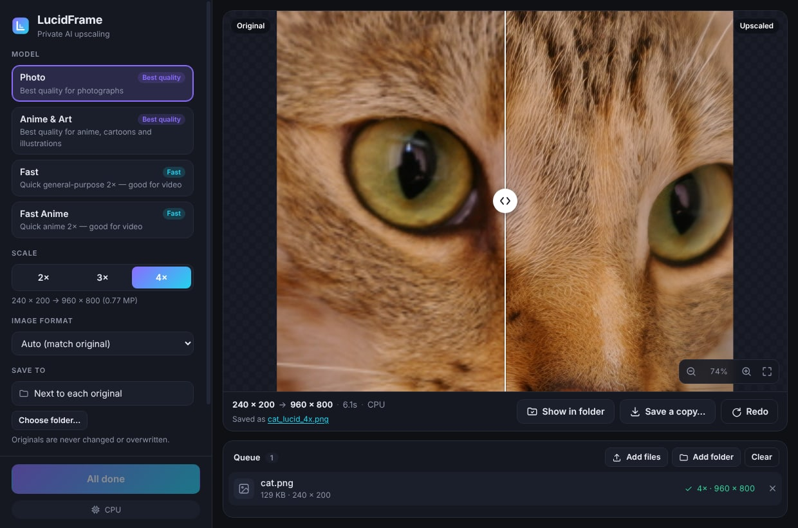
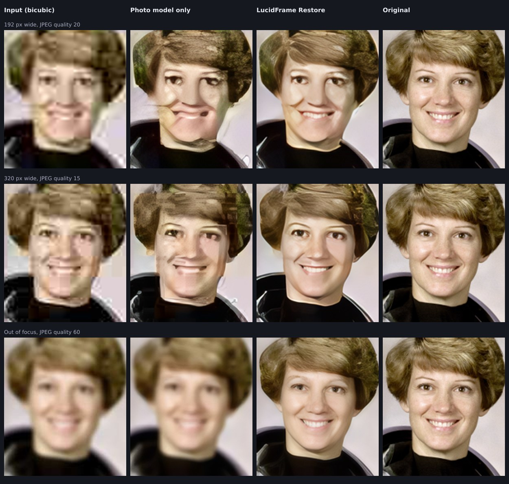

# LucidFrame

**Offline AI upscaler for images and video.** Drop a file, pick a model, get up to 4× the resolution — entirely on your own computer. Nothing is uploaded, there is no account, and there is nothing to set up.



- **Modern models** — RealPLKSR (2024) for photos and anime, a compact network for fast video.
- **Restore pipeline** — several models work together. Blocky JPEGs and out-of-focus photos are repaired *before* upscaling, and small or damaged faces are rebuilt afterwards. It decides by itself what an image needs. [Details and results below.](#restore-multiple-models-working-together)
- **Photos and video** — images up to 4×; video keeps its frame rate and audio, with optional motion-interpolated "smooth" playback.
- **Fast on whatever you have** — DirectML on any Windows GPU (NVIDIA, AMD, Intel), CoreML on Apple Silicon, CPU everywhere. It picks the best one and falls back automatically if something goes wrong.
- **Private by design** — no network access, no listening port, no telemetry. Originals are never modified or overwritten.
- **Real before/after viewer** — draggable divider, zoom to 100%, batch queue with progress and cancel.

## Install

### Just want to use it?

Download the installer for your system from the [**Releases**](https://github.com/Cosmos-0118/LucidFrame/releases) page and run it. That's the whole setup — the AI models are included, and nothing is downloaded on first launch.

| System | File | Notes |
| --- | --- | --- |
| Windows 10/11 (64-bit) | `LucidFrame-*-win-x64.exe` | One-click, per-user install, no admin prompt. GPU acceleration works out of the box. If SmartScreen warns about an unknown publisher, choose **More info → Run anyway** (builds are not code-signed yet). |
| macOS (Apple Silicon) | `LucidFrame-*-mac-arm64.dmg` | Drag to Applications. Builds are not notarized yet: right-click the app → **Open** the first time. |
| Linux (64-bit) | `LucidFrame-*-linux-x86_64.AppImage` or `.deb` | AppImage: `chmod +x` it and run. Runs on CPU (see [GPU on Linux](#gpu-on-linux)). |

### Run from source

You need [Node.js](https://nodejs.org) 22.12 or newer. That's all — no Python, no virtual environments, no separate backend to start.

```bash
git clone https://github.com/Cosmos-0118/LucidFrame.git
cd LucidFrame
npm install
npm start
```

`npm start` builds the interface if needed and opens the app. Everything else (the engine, models, ffmpeg) is already in place.

## Using it

1. **Drop** images or videos onto the window (or **Choose files / folder**). Several at once is fine — they form a queue.
2. **Pick a model and a scale.** Photo/Anime for the best quality, Fast for video or when you're in a hurry.
3. Click **Upscale**. Results are saved **next to the original** as `name_lucid_4x.png` (or into a folder you choose). Existing files are never overwritten.
4. Drag the divider to compare, scroll to zoom, double-click to jump between fit and 100%.

### Restore: multiple models working together

An upscaler can only enlarge what is in the picture. If the picture is a low-quality JPEG, it enlarges the compression blocks; if it is out of focus, it enlarges the blur; if a face is a few dozen pixels wide, it invents a wrong one. So LucidFrame runs a small pipeline around the upscaler, entirely on your machine:

```
 photo ─► 1. Clean up ─► 2. Upscale ─► 3. Restore faces ─► result
          (blocks, blur)   (your model)   (small / damaged faces)
```

1. **Clean up** (RealPLKSR 1×, trained on JPEG damage and blur). In **Auto** it runs only when it detects 8×8 JPEG blocking or a soft, out-of-focus image, and blends in more gently for borderline cases. Clean, sharp photos are left alone (forcing it on those makes them *worse*).
2. **Upscale** with the model you chose.
3. **Restore faces** (YuNet finds faces and landmarks, GFPGAN 1.4 rebuilds each aligned face, and the result is colour-matched and blended in through a soft mask). In **Auto** it acts on small or degraded faces and fades out as a face gets large and already detailed; **Always** restores every face.

Each stage can be set to Auto, On/Always or Off in the app (**Restore** section) or on the command line (`--cleanup`, `--faces`). The result bar says what was applied.



Perceptual distance to the original, measured with LPIPS (lower is better) on the example above, 4× results compared at the original size:

| Input | Method | Face | Whole image |
| --- | --- | --- | --- |
| 192 px wide, JPEG q20 | Bicubic | 0.409 | 0.408 |
| | Photo model only | 0.119 | 0.210 |
| | **Restore (auto)** | **0.100** | **0.188** |
| 320 px wide, JPEG q15 | Bicubic | 0.238 | 0.265 |
| | Photo model only | 0.109 | 0.171 |
| | **Restore (auto)** | **0.079** | **0.163** |
| Out of focus, JPEG q60 | Bicubic | 0.445 | 0.346 |
| | Photo model only | 0.426 | 0.322 |
| | **Restore (auto)** | **0.055** | **0.145** |
| 384 px wide, JPEG q70 (mild) | Photo model only | 0.032 | 0.090 |
| | **Restore (auto)** | 0.029 | 0.090 |

Honest notes: these are synthetic degradations of one public-domain portrait (NASA's official photograph of Eileen Collins), plus checks on other photos in the test suite, not a benchmark. PSNR/SSIM do not improve in the hardest cases (they penalise any invented detail), which is why LPIPS is shown. The last row shows Auto doing nothing harmful when little is wrong. **Face restoration invents plausible detail**, so a person's likeness can change slightly: keep it on Auto or switch it off if fidelity matters more than looks. Block-aligned pixel art can be mistaken for compression; set cleanup to Off for it.

### Models

All four upscalers ship with the app and run offline, together with the three Restore components (about 115 MB).

| Model | Scale | Best for | Speed* |
| --- | --- | --- | --- |
| **Photo** | 4× native | Photographs, scans, web images | ~90 s per input megapixel |
| **Anime & Art** | 4× native | Anime, cartoons, illustrations | ~105 s per input megapixel |
| **Fast** | 2× native | Video, quick previews, anything | ~5 s per input megapixel |
| **Fast Anime** | 2× native | Anime video | ~6 s per input megapixel |

\*CPU only, measured on a 4-core server CPU; a modern desktop CPU is faster and a GPU is far faster. A 1920×1080 photo is 2 MP. Any scale from 2× to 4× works with any model: a 4× model is resized down for 2×/3×, a 2× model is applied twice for 3×/4×.

### Command line

The same engine, without a window — handy for scripts and batch jobs:

```bash
npm run cli -- photo.jpg                       # best photo model, 4×
npm run cli -- clip.mp4 -m fast -s 2           # video, fast model, 2×
npm run cli -- *.png -m anime --out-dir out    # batch
npm run cli -- doctor                          # verify models, GPU/CPU inference, codecs, ffmpeg
```

```bash
npm run cli -- old-portrait.jpg --cleanup on --faces always    # force both Restore stages
npm run cli -- logo.png --cleanup off --faces off              # plain upscale, no extras
```

Run `npm run cli -- --help` for every option (`--format`, `--quality`, `--smooth`, `--cleanup`, `--faces`, `--face-strength`, `--device`, `--json`…).

## Troubleshooting

Use **Help → Run self-check…** in the app (press Alt to show the menu on Windows/Linux), or `npm run doctor` from source. It checks that the models and Restore components are intact, runs a real inference and each Restore stage, and reports which device is used, in a few seconds.

- **It's slow.** Check the device chip in the bottom-left of the app. "CPU" means no GPU was found; use the **Fast** model, or a smaller scale. On Windows and Apple Silicon a GPU is used automatically.
- **Logs** live in `%APPDATA%\LucidFrame\logs` (Windows), `~/Library/Application Support/LucidFrame/logs` (macOS) or `~/.config/LucidFrame/logs` (Linux). **Help → Open log folder** opens them.
- **"The processing engine stopped unexpectedly".** The machine most likely ran out of memory. Use a smaller scale or the Fast model. The app restarts its engine by itself; nothing needs to be relaunched.
- **Linux AppImage won't start on Ubuntu 24.04+.** The app detects the OS restriction on Chromium's sandbox and adapts. If you still hit issues, run it with `--no-sandbox`.

Environment variables (all optional): `LUCIDFRAME_DEVICE` = `auto` · `cpu` · `dml` · `cuda` · `coreml`; `LUCIDFRAME_MODELS` (models folder); `LUCIDFRAME_FFMPEG` (use your own ffmpeg); `LUCIDFRAME_LOG_LEVEL` = `debug` · `info` · `warn` · `error`; `LUCIDFRAME_DML_DEVICE` (DirectML adapter index, default 0).

### GPU on Linux

The Windows (DirectML) and macOS (CoreML) builds are GPU-accelerated with no extra steps. On Linux the packaged AppImage/.deb run on CPU. NVIDIA owners can run from source: `npm install` fetches ONNX Runtime's CUDA provider, which is used automatically when the CUDA runtime libraries are installed on the machine.

## How it works

```
 ┌──────────────┐  IPC (no network)  ┌───────────┐  messages  ┌────────────────────────────────┐
 │ React UI     │◄──────────────────►│ Electron  │◄──────────►│ Engine process                 │
 │ (sandboxed)  │                    │ main      │            │ ONNX Runtime · sharp · ffmpeg  │
 └──────────────┘                    └───────────┘            └────────────────────────────────┘
```

- **Engine** (`src/engine`): tiled inference with mirrored context and cross-faded overlaps (no visible seams), automatic device selection (DirectML → CUDA → CoreML → CPU) with fallback to smaller tiles and then CPU if a GPU runs out of memory. Videos stream through two ffmpeg processes — decode → model → encode — so no frames are written to disk, the frame rate is preserved and audio is carried over.
- **App** (`src/main`, `src/renderer`): the UI never touches the filesystem or the network. It refers to files by id, media is served through unguessable tokens, every IPC call is validated, and a strict Content-Security-Policy forbids remote code. The engine runs in its own process, so a crash can't take the window down.
- **Restore** (`src/engine/restore`): blockiness and softness detectors, YuNet face detection, similarity-transform alignment, GFPGAN restoration, colour matching and mask blending. Optional stages: if one cannot run, the job still finishes and says so.
- **Models** (`models/`): ONNX files verified by SHA-256 before use. `tools/convert_models.py` rebuilds them from the pinned upstream weights.

## Development

```bash
npm run dev          # UI with hot reload + the app
npm test             # engine, models, ffmpeg, CLI, host protocol, security helpers
npm run test:e2e     # drives the real Electron app (on Linux: xvfb-run npm run test:e2e)
npm run pack         # unpacked app in release/   ·   npm run smoke:packaged to check it
npm run dist         # installer for the current OS (CI builds all three: see .github/workflows)
```

To cut a release, push a tag like `v2.0.0`; GitHub Actions builds the Windows, macOS and Linux installers and attaches them to the release.

Converting or adding models needs Python once (see the header of `tools/convert_models.py`); end users and normal development never do.

## Upgrading from v1

v1 was a Python/FastAPI backend (PyTorch, Real-ESRGAN, GFPGAN) started alongside an Electron front end, with PowerShell setup scripts. v2 replaces that stack:

| | v1 | v2 |
| --- | --- | --- |
| Setup | Python 3.11, venv, PowerShell scripts, model downloads, ffmpeg download | `npm install && npm start` — or just an installer |
| Processes | Electron + separate backend on `localhost:8000` | Electron + an internal engine process, no port |
| Models | Real-ESRGAN x4plus/x2plus/anime (2021), GFPGAN | RealPLKSR (2024) and compact models, bundled |
| Video | Every frame written to PNG, fixed 25 fps | Streamed through ffmpeg, original fps and audio kept |
| Filters | Sharpen, denoise, brightness, contrast, saturation, presets | Removed — models do the enhancing |
| Face restore | GFPGAN toggle (PyTorch) | Restore pipeline: GFPGAN 1.4 in ONNX, with face detection and alignment, plus JPEG/blur cleanup |
| Platforms | Windows only | Windows, macOS (Apple Silicon), Linux |

## Credits & licenses

LucidFrame is [MIT licensed](LICENSE). The bundled models are CC-BY-4.0 and require attribution; see [NOTICES.md](NOTICES.md) for the models, authors, and every third-party component.
